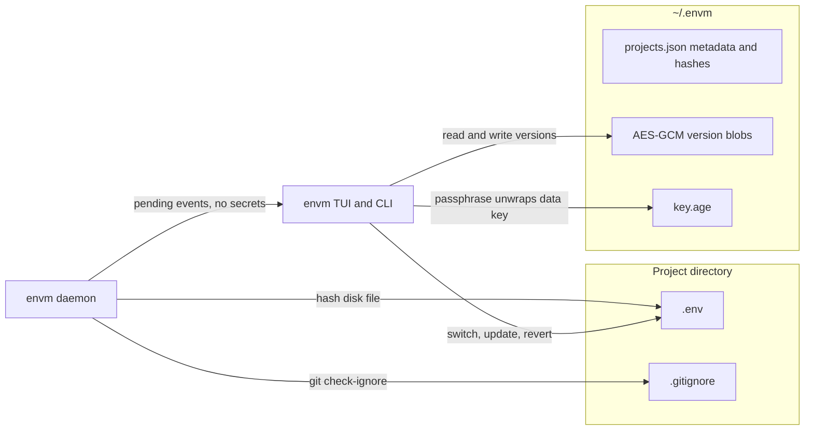

# envm: versioned .env manager

Greenfield module [`martinshaw.co/environment-manager`](cmd/envm/main.go) in this empty repo. Binary name `envm`, version `0.1.0`, license GPL-3.0-only. Local branch `main` (no commits) will be renamed to `master` before the first commit. Remote: public `martinshaw/environment-manager`, default branch `master`.

## How the pieces fit



The daemon never receives the passphrase or plaintext versions. It compares the on-disk `.env` to a SHA-256 stored beside each version. Update, new file, and revert run only after `envm` has unlocked the vault.

## Storage and encryption

Directory `~/.envm`, mode `0700`. Files mode `0600`. Mutations take a lock via `github.com/gofrs/flock`.

- [`internal/crypto`](internal/crypto): on first run, generate a random 32-byte data key. Wrap it with [`filippo.io/age`](https://filippo.io/age) to a passphrase (scrypt) and to a one-time recovery identity. Show the recovery key once. `envm` prompts for the passphrase at start (hidden input) and keeps the data key in that process only. Forgotten passphrase without the recovery key cannot be undone; the README will say so.
- Version bytes are encrypted with AES-GCM. Each version also stores a plaintext SHA-256 so a locked daemon can detect drift.
- Plaintext metadata in `projects.json`: project id, display name, absolute path, selected env id, env names, version number, timestamp, hash, blob filename. Secret values stay in `content/<id>.bin`.
- Full snapshot per version (`v1`, `v2`, `v3`, …), not a patch chain. `.env` files are small, and a broken patch would corrupt credentials. Unified diffs are computed when shown, using `github.com/pmezard/go-difflib`.
- Bytes are stored and written exactly. The tool will not reformat quotes or add a trailing newline on its own.

## Projects, selection, and commands

Roots live in `config.json` (not secret). First launch asks you to add roots; nothing is hardcoded. Projects are the non-hidden child directories of those roots, initially named after the directory. Rescans add new directories and keep edited names. Missing directories stay in the list, marked missing. You can edit the display name and the path, and hide a project from the list without deleting the directory.

One stored env file per project is **selected**: its latest version is what should be in `<project>/.env`.

CWD commands resolve the project by exact path, then by the nearest ancestor that is a known project. They do not treat a configured root itself as a project.

- `envm` opens the TUI
- `envm use "Staging Todo App"` writes that env’s latest version to `./.env` and selects it
- `envm update` if `./.env` differs from the selected env’s latest version, stores the next version
- `envm new "Production App"` stores `./.env` as a new named env at `v1` and selects it
- `envm revert` writes the selected latest version back over `./.env`
- `envm diff` prints a unified diff of `./.env` against the selected latest version
- `envm drift` opens the action prompt for pending watcher events, or for the CWD project
- `envm roots add|remove|list`
- `envm daemon install|uninstall|start|stop|status|run`
- `envm completion bash|zsh|fish|powershell`
- `envm version`

Writes from the tool record the applied hash so the watcher does not immediately report its own change.

## TUI

Bubble Tea stack: `bubbletea` v1.3, `bubbles` v1, `lipgloss` v1. Sidebar plus main pane. The sidebar is three stacked searchable lists: projects, env files, versions. The main pane shows the breadcrumb `Project / Env file / vN` and the file contents.

Empty-filter order puts the important row first: the CWD project, the selected env file, and the latest version. With a filter, `sahilm/fuzzy` still ranks that pinned row above an equal match. `/` filters the focused list. In the main pane, `/` searches the file and `n` / `N` move between hits.

Main-pane actions, each confirmed where destructive:

- edit contents; saving creates the next version. If that env is selected, also write `<project>/.env`
- delete a version, an env file, or a project index entry. Deleting does not delete the project directory or the on-disk `.env`
- comment and uncomment the current line by toggling a leading `#`, then save as the next version
- diff the open version against the previous one (`v1` has none). A second command diffs the disk file against the latest stored version when they differ
- lint: line-accurate dotenv check for unterminated quotes, empty or illegal keys, duplicate keys, and `export KEY=VALUE`. Comments and blank lines are valid. Results show in an overlay
- copy menu: Teams markdown fence (````env` … `````), plain text, or unified diff, via `github.com/atotto/clipboard`

Narrow terminals collapse to one pane and `tab` switches sidebar and contents. `?` shows the key help.

When the daemon has a pending drift or gitignore finding, the TUI opens on that prompt: **Update** (next version of the selected env), **New file** (asks for a name, stores `v1`, selects it), **Revert**, or **Dismiss**.

## Daemon and file watching

`envm daemon install` registers a login service that runs `envm daemon run` using the installed binary path:

- macOS: `~/Library/LaunchAgents/co.martinshaw.envm.plist` (`RunAtLoad`, `KeepAlive`)
- Linux: `~/.config/systemd/user/envm.service`, enabled with `systemctl --user`
- Windows: a logon scheduled task

`fsnotify` watches each root (so new project directories are picked up) and each project directory (so atomic editor saves of `.env` and `.gitignore` are seen). Events are debounced. State transitions are stored in `state.json` so the same finding is not re-notified.

- `.env` hash differs from the selected latest hash: notify “update, save as a new file, or revert”, and append a pending event
- `.gitignore` does not cover `.env`: notify. In a git repo this uses `git check-ignore` and also warns if `.env` is already tracked (`git ls-files`). Without git, a small gitignore match is used. Dismissal sticks until the ignore state changes

Notifications go through the platform tool (`osascript`, `notify-send`, Windows toast). The pending queue is the source of truth. Linux notifications use a default action that launches `envm drift` when the notifier supports actions. The daemon listens on `127.0.0.1` and writes the port plus a `0600` token into `~/.envm` so the TUI can subscribe to events. The socket carries event ids and project names only.

If the daemon is not running, the TUI watches the same way for that session.

## Repo, docs, and release

- [`PROMPT.md`](PROMPT.md): the original request, unchanged
- [`LICENSE`](LICENSE): GPL-3.0-only, copyright Martin Shaw, 2026
- [`README.md`](README.md): table of contents, install, concepts, commands, TUI keys, daemon, encryption and the recovery-key warning, gitignore checks, development, license. Install prefers release archives. Document the `go-import` meta tag required before `go install martinshaw.co/environment-manager@latest` will resolve
- [`CHANGELOG.md`](CHANGELOG.md): 0.1.0 notes, used as the GitHub release body
- [`.github/workflows/ci.yml`](.github/workflows/ci.yml): `go test ./...` on Linux, macOS, and Windows
- [`.github/workflows/release.yml`](.github/workflows/release.yml) and [`.goreleaser.yaml`](.goreleaser.yaml): on `v*` tags, `CGO_ENABLED=0` builds of `envm` for darwin, linux, and windows, amd64 and arm64, tar.gz (zip on Windows), checksums, and release notes from `CHANGELOG.md`. `main.version` set with ldflags
- [`.gitignore`](.gitignore): binaries, `dist/`, `.env`

Tests cover dotenv lint and comment toggling, encrypt/decrypt round trip, version bumps only when the hash changes, CWD project resolution, unified diff and markdown copy wrapping, and gitignore coverage in a temporary git repo.

After the tree is in place: rename `main` to `master`, commit, create the empty public repo, push `master`, and set it as the default branch if GitHub still points at `main`. Tag `v0.1.0` and push the tag so the release workflow publishes binaries and the changelog.